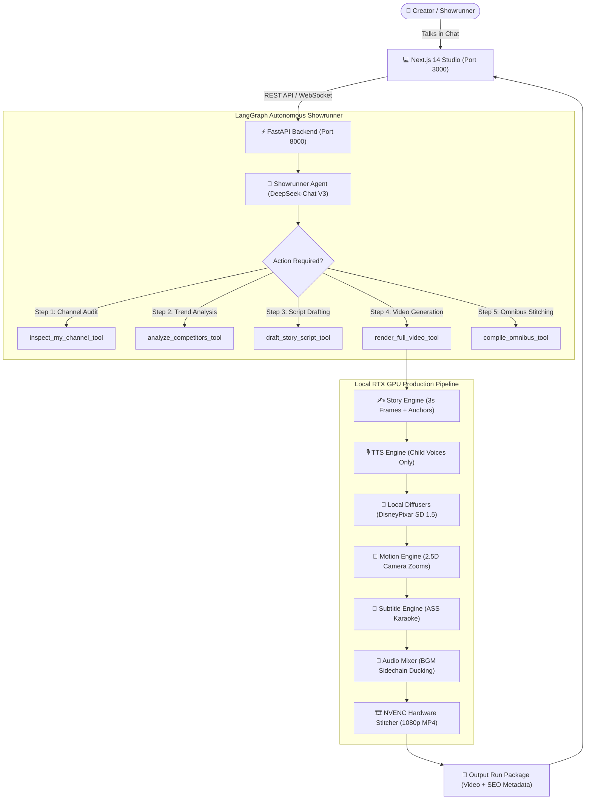

# 🎬 AI Video Generation Studio — Autonomous Showrunner Agent

<div align="center">


**An autonomous AI animation studio that researches viral competitors, writes situational fairy tales, renders 3D Disney/Pixar illustrations locally on consumer GPUs, and edits full 1080p MP4 videos with child-only voiceovers.**

[Key Features](#-key-features) • [Architecture](#-architecture) • [Getting Started](#-getting-started) • [Hardware Requirements](#-hardware-requirements) • [Agent Tools](#-agent-tools) • [License](#-license)

</div>

---

## 🌟 Key Features

- 🤖 **LangGraph Showrunner Agent**:
  An autonomous director equipped with cyclic tool execution. It audits your channel profile, analyzes high-retention competitor videos (>1M views), crafts scripts, and renders videos end-to-end.
- 🎨 **100% Local GPU Visuals (Zero API Costs)**:
  Generates 3D Disney/Pixar-style illustrations directly on local consumer GPUs (tested on **RTX 2050 4GB VRAM**) using `Yntec/DisneyPixarCartoon768` via Diffusers fp16 with zero cloud billing.
- 🧒 **Strict Sweet Child Voices**:
  Enforces child-only neural voices (`en-US-ChristopherNeural` and `en-US-AnaNeural`) via Edge-TTS with sub-word timing synchronization. Zero robotic or adult narration.
- ⏱️ **Pacing & 1:1 Situational Match**:
  High-retention ~3-second frame cuts matching spoken dialogue 1:1. Visual prompts are anchored with consistent character designs across scenes.
- 🎥 **Hardware-Accelerated Motion & Assembly**:
  Butter-smooth 2.5D slow camera zoom/pan, sidechain-ducked background music, and animated ASS karaoke subtitles rendered via **NVIDIA NVENC** (30fps).
- 📱 **Dual Format Engine**:
  - **9:16 Shorts** (`720x1280`) for YouTube Shorts, TikTok, and Instagram Reels.
  - **16:9 Widescreen** (`1280x720`) for long-form episodes and continuous **30-minute Bedtime Story Omnibus Compilations**.
- 💻 **Modern Web Studio**:
  Full-stack Next.js 14 + Tailwind CSS dashboard featuring direct conversational agent chat, live video review, one-click YouTube SEO metadata (Title, Description, Chapters, Tags), and frame storyboards.

---

## 📐 Architecture



---

## 🖥️ Hardware Requirements

| Component | Minimum | Recommended |
|---|---|---|
| **GPU** | NVIDIA GPU with **4GB VRAM** (e.g. RTX 2050, GTX 1650) | NVIDIA GPU with **8GB+ VRAM** (RTX 3060, 4060+) |
| **System RAM** | 16 GB | 32 GB |
| **Storage** | 10 GB free space for model weights & media | 25 GB SSD |
| **OS** | Windows 10/11 or Ubuntu 20.04+ | Windows 11 / Linux with NVIDIA drivers |

---

## 🚀 Getting Started

### 1. Prerequisites
- **Python 3.10 or 3.11** installed
- **Node.js 18+** installed
- **FFmpeg** installed and accessible in your system PATH (with `nvenc` support recommended)

### 2. Clone the Repository
```bash
git clone https://github.com/si451/AI-VIDEO-GENERATION.git
cd AI-VIDEO-GENERATION
```

### 3. Backend Setup (Python)
Create and activate a virtual environment:
```bash
# Windows PowerShell
python -m venv venv
.\venv\Scripts\Activate.ps1

# Linux / macOS
python3 -m venv venv
source venv/bin/activate
```

Install dependencies:
```bash
pip install -r requirements.txt
```

Set up your environment variables:
```bash
cp .env.example .env
```
Open `.env` and add your **DeepSeek API Key** (and optional HuggingFace token for expedited model downloading):
```env
DEEPSEEK_API_KEY=your_deepseek_api_key_here
HF_TOKEN=your_optional_hf_token_here
```

### 4. Frontend Setup (Next.js)
```bash
cd web
npm install
npm run build
cd ..
```

---

## 🎬 Running the Studio

### Step 1: Start the Backend Server
```bash
python server.py
```
*Backend runs on `http://localhost:8000` (FastAPI + Swagger docs at `/docs`).*

### Step 2: Start the Next.js Web Studio
In a separate terminal:
```bash
cd web
npm start -- -p 3000
```
Open your browser to: **`http://localhost:3000`**

---

## 💬 How to Use with the AI Agent

You can control the entire animation studio directly through conversation in the web chat:

### 1. Auto-Produce a 9:16 YouTube Short (~30s)
> *"Audit our channel @WhimsyWandTales, research viral competitor hits, and produce an autonomous 9:16 Short starring Pip the Baby Dragon with strict child voices."*

### 2. Plan a 30-Minute Bedtime Story Omnibus (16:9)
> *"Analyze our channel and draft Chapter 1 of a 16:9 bedtime story compilation starring Barnaby Bear. Keep scene holding times gentle and soothing for toddlers."*

### 3. Compile Multiple Stories into a Master Omnibus
> *"Use compile_omnibus_tool to stitch all our completed 16:9 chapters into a single master 30-minute compilation video with YouTube chapter timestamps."*

---

## 📂 Repository Structure

```
AI-VIDEO-GENERATION/
├── agent.py                 # LangGraph ReAct Agent definition & prompt
├── server.py                # FastAPI REST & WebSocket server
├── harness.py               # End-to-end production harness pipeline
├── config.py                # Global settings, aspect ratios, voice maps
├── benchmark_local_model.py # VRAM & local diffusion model benchmarker
├── modules/
│   ├── agent_tools.py       # LangGraph tool definitions (Channel, TTS, Render)
│   ├── story_engine.py      # LLM scriptwriting & frame breakdown
│   ├── visual_engine.py     # Local Diffusers (DisneyPixar SD 1.5)
│   ├── tts_engine.py        # Edge-TTS child voice synthesis
│   ├── motion_engine.py     # 2.5D slow zoom & pan camera renderer
│   ├── subtitle_engine.py   # ASS karaoke animated subtitle burner
│   ├── audio_mixer.py       # Multi-track ducking & background audio
│   ├── competitor_engine.py # YouTube competitor viral trend scraper
│   └── assembler.py         # NVENC hardware master assembly & omnibus
├── memory/
│   ├── my_channel.json      # Channel profile, mascots, published video audit
│   └── channel_insights.json# Scraped competitor viral analytics
├── web/                     # Next.js 14 Web Studio application
│   ├── app/                 # App router pages (Studio, Dashboard)
│   └── package.json         # Frontend dependencies
└── requirements.txt         # Python dependencies
```

---

## 🛠️ CLI Standalone Mode

You can also run the harness directly from the command line without the web interface:

```bash
# Generate a 9:16 vertical short (10 frames, ~30s)
python harness.py --topic "Pip and the Glowing Acorn" --frames 10 --aspect 9:16

# Generate a 16:9 long widescreen story (15 frames, ~45s)
python harness.py --topic "Barnaby's Forest Honey Quest" --frames 15 --aspect 16:9
```

---

## 📜 License

This project is licensed under the **MIT License** — you are free to use, modify, distribute, and build commercial applications upon it. See the [LICENSE](LICENSE) file for details.

---

<div align="center">
Made with ❤️ for indie animators, creators, and AI storytellers.
</div>

